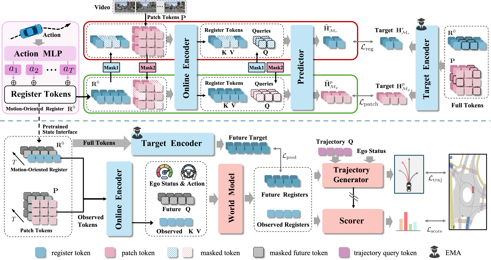

# MORE: Learning Motion-Oriented Registers for Driving World Models and Planning

[[Paper](https://arxiv.org/abs/2610.14871)] [[Code](https://github.com/Cyril-gyd/MORE)]

---

## Code and Models

We are preparing the code, and models for public release. The repository will be updated progressively. 

## Overview

**MORE** is a V-JEPA framework that learns **M**otion-**O**riented **RE**gisters during video pretraining as a compact state interface for driving world models and planning. It addresses the *state-interface mismatch* between dense visual representations learned during pretraining and the motion-sensitive, predictive states required by downstream world models and planners.

During pretraining, MORE injects temporally aligned ego motion into a small set of register tokens. Masked patch representations are predicted exclusively through these registers, routing dense visual supervision through a compact state bottleneck. A complementary blockwise register-masking objective further encourages predictive structure in the learned state space. During downstream training, the same register space is reused for non-autoregressive future-state prediction, trajectory generation, and trajectory scoring.

<p align="center">
  
</p>

<p align="center">
  <em>MORE learns motion-oriented registers during video pretraining and reuses the same compact state space for world modeling and trajectory planning.</em>
</p>


## Citation

If you find MORE useful in your research, please consider citing our work:

```bibtex
@misc{gu2026morelearningmotionorientedregisters,
      title={MORE: Learning Motion-Oriented Registers for Driving World Models and Planning}, 
      author={Yingdong Gu and Haoyu Wang and Shaocheng Yan and Zhenjun Zhao and Hao Han and Pengcheng Shi and Xianfei Li and Qinghua Tan and Wenlong Liao and Tao He and Jiayuan Li and Pai Peng},
      year={2026},
      eprint={2610.14871},
      archivePrefix={arXiv},
      primaryClass={cs.CV},
      url={https://arxiv.org/abs/2610.14871}, 
}
```
